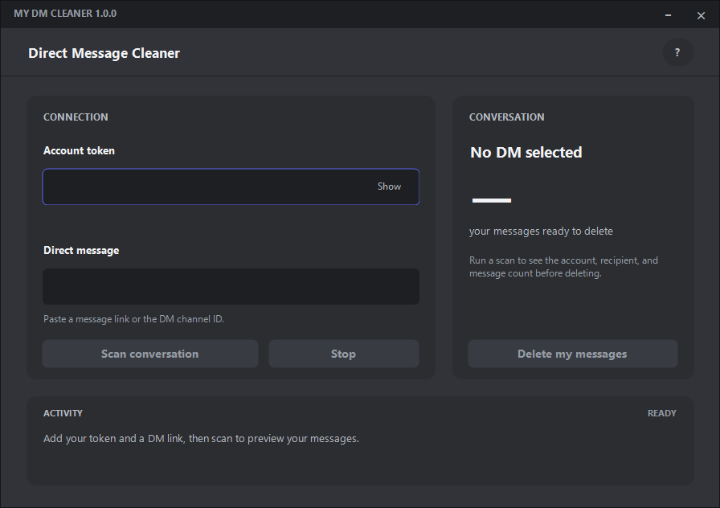
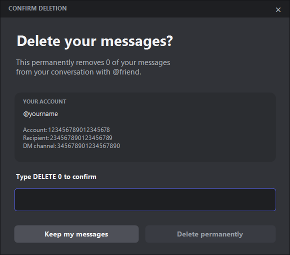

# Discord DM Cleaner

Review and delete **your own messages** in a one-to-one Discord DM. Windows only. No installer.

[](https://github.com/Nuqb/discord-dm-cleaner/releases/download/v1.0.1/Discord-DM-Cleaner-v1.0.1-Windows.zip)

[All releases](https://github.com/Nuqb/discord-dm-cleaner/releases)

[MIT License](LICENSE) | [Contributing](CONTRIBUTING.md)



### Get started

1. **Download** the ZIP above, right-click it, then choose **Extract All**.
2. Open **DiscordDmCleaner.exe**. Requires Windows with .NET Framework 4.x. The app is unsigned; Windows may show a reputation warning. Only run downloads you trust.
3. Click **?** for setup help. Enter your account token locally and paste a DM message link.
4. **Scan conversation**, check the account, recipient, and count, then choose **Delete my messages** and confirm.



**Before you use it:** deletion is permanent. Your token gives access to your account; never share it. This app automates a personal account, which [Discord prohibits and says can lead to account termination](https://support.discord.com/hc/en-us/articles/115002192352-Automated-User-Accounts-Self-Bots). Manual deletion in Discord is the supported alternative. This is an unofficial tool.

Only one-to-one DMs are supported. Other people's messages, group DMs, and server channels are excluded. **Stop** interrupts further work; a request already sent may finish. Scan again after stopping.

---

## For developers

### Build, test, package

Windows PowerShell and the .NET Framework 4.x C# compiler are required. No NuGet packages or SDK restore are needed.

```powershell
powershell -NoProfile -ExecutionPolicy Bypass -File scripts/build.ps1             # Build
powershell -NoProfile -ExecutionPolicy Bypass -File scripts/build.ps1 -Test       # Build + simulated tests
powershell -NoProfile -ExecutionPolicy Bypass -File scripts/build.ps1 -Package    # Test + ZIP + SHA-256
```

Build output goes to `artifacts/bin/`; downloads go to `artifacts/release/`. Packaging requires a fresh staging directory to avoid stale files. Tests include WinForms interactions and need an interactive Windows desktop.

### Repository layout

```text
src/                 API client, cleanup logic, Windows UI, version metadata
tests/               Simulated API and desktop regression tests
assets/              Application icon
docs/                Download instructions, release notes, example screenshots
scripts/build.ps1    Build, test, and package entry point
.github/workflows/   Windows checks and version-tag releases
VERSION              Public release version
```

Old local prototypes (`work/`, `outputs/`) and all generated binaries are ignored. Release downloads are attached to GitHub Releases rather than committed.

### Privacy and behavior

The token is supplied manually, kept in process memory, and sent only to Discord's HTTPS API as an Authorization header. The client disables redirects. It does not read saved credentials, the clipboard, or Discord's process/files. It does not persist tokens or message history; closing the app is not a guarantee of secure memory erasure by Windows.

Scanning paginates available history and filters by the authenticated account. Deletion uses the completed scan, rechecks account and recipient, then verifies each message's exact ID, channel, and author. Rate-limit responses are honored. System entries are excluded. Copies, screenshots, and downloaded attachments cannot be recalled.

Tests use fake responses and example identities only. **No live account compatibility or real deletion has been verified.** Discord may refuse these requests or change its API. Never put real tokens or private conversation data in issues, screenshots, tests, or commits.

### Releasing

Update `VERSION`, assembly metadata, UI title, client user agent, download links, and release notes together. Run `scripts/build.ps1 -Package` on Windows. Push the reviewed commit and a matching `v1.0.1` style tag; the release workflow builds, tests, and attaches the portable ZIP and `SHA256SUMS.txt`. A tag/version mismatch fails the workflow.

See [release notes](docs/RELEASE-NOTES.md).

### License and contributing

Released under the [MIT License](LICENSE). You can use, modify, and distribute the code, including commercially, while retaining the copyright and license notice. The software is provided without warranty. Discord branding remains subject to its owners' rights; see [NOTICE](NOTICE).

Bug reports and pull requests are welcome. See [CONTRIBUTING.md](CONTRIBUTING.md) for setup, testing, and submission guidelines.


Want the logo for your profile? See [logo files and README embed snippet](docs/BRANDING.md).
